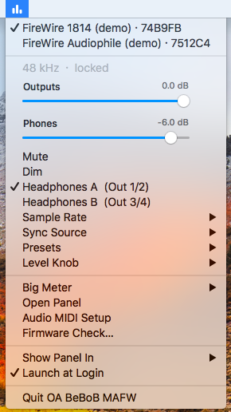
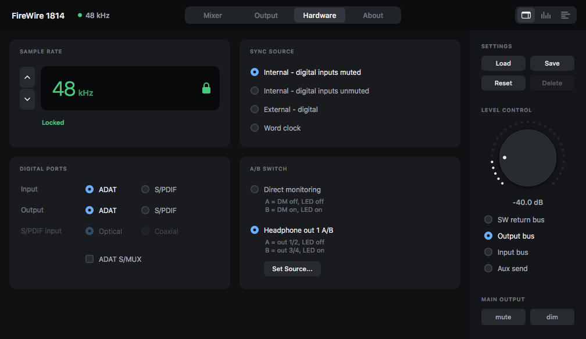

# OpenAudio BeBoB MAFW

**A native driver, control panel and installer for the M-Audio FireWire 1814 and FireWire Audiophile on macOS 10.13.6 High Sierra.**

The FireWire 1814 (18 in / 14 out) and the FireWire Audiophile (4 in / 6 out) are BridgeCo BeBoB FireWire interfaces that M-Audio stopped supporting years ago. The last official driver (1.11.x, 2014) kernel-panics on macOS 10.13.6, and its Carbon control panel is 32-bit only. OpenAudio BeBoB MAFW is a from-scratch replacement — a 64-bit kernel extension, a helper daemon, a modern AppKit control panel (**OA BeBoB MAFW**) and an installer — built by reverse engineering the official driver and checking every behaviour against the real hardware. It succeeds **OpenAudio FW1814 0.1.0** (FireWire 1814 only), which its installer replaces.

<p align="center"></p>

> **Who this is for.** Only people who own an **M-Audio FireWire 1814 or FireWire Audiophile**. It does nothing without the interface. The original M-Audio software belongs to M-Audio / inMusic — see [`NOTICE.md`](NOTICE.md).

> **Homebrew and experimental.** A hobby project, not a product: the kernel extension is **unsigned and will stay unsigned**, so it runs only with **System Integrity Protection disabled**, and nothing is promised or supported.

> **Status: package 0.2.2** (driver 0.2.0, panel 1.3; see [`CHANGELOG.md`](openaudio-mafw-bebob/CHANGELOG.md)). Tested with **one FireWire 1814 and one FireWire Audiophile, alone and together on the same bus, on an iMac (iMac11,2, native FireWire 800)**, and installed from the disk image on a **MacBook Air (MacBookAir5,1) through Apple's Thunderbolt-to-FireWire adapter** — both on macOS 10.13.6 with SIP disabled. Nothing else has been tested. Read [Known issues](#known-issues) before installing.

---

## What it is

| Component | What it does |
|---|---|
| **Kernel extension** (`com.openaudio.OpenAudioBeBoBMAFW`) | Matches the interfaces on the FireWire bus, brings them up (AV/C, CMP, isochronous streams with classic DCL programs) and publishes a CoreAudio device per unit with the hardware mixer properties, peak meters and MIDI ports. One driver for both models, structured like the official driver's class family: a shared base plus one module per model. |
| **Helper daemon** (LaunchDaemon) | Starts the interface firmware after power-up (the Audiophile waits in its bootloader until told to start) and remembers your settings per unit, replaying them when the driver attaches. A unit with no saved settings gets its headphone level lowered to −43 dB. It never writes the interface's flash. |
| **Control panel** (`OA BeBoB MAFW.app`) | Mixer, output, hardware and meter views for each model, presets, level knob, a device menu for several units, an optional **menu bar mode** with a status menu, a segmented **big meter**, and a read-only **firmware check** (is each unit running the official 1.11.2 firmware of its model?). Talks to the driver through registry properties, like the original panel. |
| **MIDI** | The original M-Audio CoreMIDI plug-in is reused **unmodified**. |
| **Installer** | `Install OA BeBoB MAFW.pkg`, a one-window **Uninstall OA BeBoB MAFW** app and a `.dmg` holding both. It **updates any earlier version in place** (0.1.0 or 0.2.x, no manual uninstall; settings kept) and asks for a restart; nothing is unloaded while it runs. |

### What works (checked on the interfaces)

**FireWire 1814:** 16 in / 12 out (ADAT), 10 in / 6 out (S/PDIF), 2 in / 4 out analog at 176.4 / 192 kHz (the digital ports are off at those rates — a hardware limit); all six rates; panel, saved settings, MIDI plug-in; real round-trip latency 9.3 ms at 48 kHz / 64 frames (analog loopback).

**FireWire Audiophile**
- **4 in / 6 out at 44.1 / 48 / 88.2 / 96 kHz**; channel order confirmed with a tone per channel and the device's own meters.
- **Round-trip latency 9.1 ms at 48 kHz / 64 frames** (analog loopback), matching what the driver reports.
- **Panel**: three software-return strips, two input strips, aux bus, outputs, phones, routing, sync, headphone A/B source matrix; a factory reset gives exactly the official driver's factory state.
- **Front panel**: Level Controller, headphone knob, A/B switch and its LEDs.
- **MIDI**: the M-Audio plug-in lists the Audiophile, 1 in / 1 out. Settings survive a driver reload.

**Both units on one bus:** both come up, both stream, both recover after the interfaces are power-cycled; the panel switches between them; the firmware check reports both as current.

**Monitor level law (this project's choice, not the official one).** Output, phones and aux-out faders are dB-linear over 72 dB (centre = −36 dB, bottom = off); the hardware knobs move those levels 1.5 dB per click by default (3 dB or the official law selectable per unit). Mixer faders keep the official console law.

**Light on the CPU:** the meters are GPU-composited layers redrawn only when a segment changes (the official panel's method); with moving meters the panel uses about 2 % of a core on a 2010 iMac.

### Menu bar and big meter (new in 0.2)

<table>
<tr>
<td valign="top" width="300"></td>
<td valign="top">

**Status menu.** The panel can live in the **menu bar**, the **Dock**, or both, and can **launch at login** (choose under *Show Panel In*). The icon shows the selected interface at a glance — **online**, **muted** or **not locked** (no sync), dimmed when no interface is connected — and its menu acts on the unit checked at the top:

- output and phones volume sliders (monitor law), **mute**, **dim**, headphones **A / B**;
- **sample rate** (greyed while an application streams) and **sync source** with the lock state;
- **presets** that fit that interface, the hardware **level knob** step;
- the **big meter**, the full panel, Audio MIDI Setup and the **firmware check**.

</td>
</tr>
</table>

<p align="center"></p>

**Big meter.** A horizontal peak meter about 80 % of the screen wide, segmented like an old stereo deck: **80 LED blocks over −60 … 0 dBFS** (0.75 dB each), green up to −18, amber up to −6, red above, unlit blocks faintly visible, a **peak-hold** block (about 2 s) and large peak readouts. Source: **SW 1/2** (default), **Out 1/2**, **Phones** or **In 1/2** of the selected unit. Right-click it (or use the status menu) for: **always on top**, **pin** to the top or bottom of the screen or move it freely, **transparent**, **click-through**. *View › Big Meter* (⌘B) toggles it. Peak only, from the driver's meter page — no RMS or loudness. Both pictures above are the panel's demo mode on a MacBook Air.

### Panel pages

<table>
<tr>
<td align="center"><br><sub>FireWire Audiophile: mixer (demo mode render)</sub></td>
<td align="center"><br><sub>FireWire Audiophile: output page</sub></td>
</tr>
<tr>
<td align="center"><br><sub>FireWire 1814: output page</sub></td>
<td align="center"><br><sub>FireWire 1814: hardware page (rate, sync, digital ports, A/B switch)</sub></td>
</tr>
</table>

---

## Compatibility

| | |
|---|---|
| **Interfaces** | **M-Audio FireWire 1814 and FireWire Audiophile only** — the hardware the author owns. The other models of the official driver (FireWire 410, FireWire Solo, Ozonic, ProFire Lightbridge, ProjectMix I/O, NRV10) are not implemented; the structure for them exists (see [Roadmap](#roadmap)). |
| **macOS** | **10.13.6 High Sierra only** (64-bit kext, 10.13 SDK, Xcode 9.4.1). |
| **Mac** | iMac11,2 with native FireWire 800; MacBook Air (MacBookAir5,1) through Apple's **Thunderbolt-to-FireWire adapter**. Other Macs, adapters and FireWire 400 are untested. |
| **Security** | **Unsigned, always**; **System Integrity Protection must be disabled** (Recovery, `csrutil disable`). |

## Install

1. Download the `.dmg` from the [Releases](https://github.com/bhsardinha/openaudio-fw1814/releases) page.
2. Quit audio and MIDI applications. Remove the official M-Audio (and Avid/DICE) FireWire drivers first; they conflict. An earlier OpenAudio version does **not** need to be removed: the installer replaces it and keeps your settings.
3. Disable System Integrity Protection if it is on (Recovery mode, `csrutil disable`).
4. Open the `.dmg`, run **Install OA BeBoB MAFW.pkg**, **restart**. (The package contains M-Audio's CoreMIDI plug-in unmodified, so that MIDI works; see [`NOTICE.md`](NOTICE.md).)
5. Power on the interface. It appears in Audio MIDI Setup; the panel **OA BeBoB MAFW** is in `/Applications`.

To remove everything run **Uninstall OA BeBoB MAFW** from the disk image and restart.

## Build from source

You need **macOS 10.13.6 with Xcode 9.4.1** (the last Xcode with the 10.13 SDK).

```sh
cd openaudio-mafw-bebob
make -C kext                 # kext/build/OpenAudioBeBoBMAFW.kext
make -C firmware-helper      # firmware-helper/build/oa-fwhelper
make -C control-panel app    # control-panel/build/OA BeBoB MAFW.app   (make -C control-panel test: logic tests)
scripts/stage-kext.sh        # copy to /tmp and run kextutil -t -n (static check; loads nothing)
```

Never copy an untested kext into `/Library/Extensions` (a panicking kext there boot-loops). The installer also needs M-Audio's `MAudioFireWireMIDI.plugin` from your own copy of the official 1.11.2 installer, placed in `openaudio-mafw-bebob/installer/assets/` (see the README there); `installer/make-dmg.sh` builds the package and the disk image. Version numbers: the package has its own number (`VERSION`), the driver and the panel keep theirs (see the top of [`CHANGELOG.md`](openaudio-mafw-bebob/CHANGELOG.md)). Bench tools are described in [`openaudio-mafw-bebob/tools/README.md`](openaudio-mafw-bebob/tools/README.md).

---

## Known issues

1. **Kernel panic seen once during playback with 0.1.0** (2026-10-17, inside Apple's IOAudioFamily `mixOutputSamples`, FireWire 1814, Studio One). A likely cause was fixed the same day; it has not been seen since, but it is not proven gone. Treat the driver as **unsafe for work you cannot afford to lose**.
2. **Do not change the rate or the digital mode while audio is playing.** The original driver panics there; this driver gates only the panel's own rate change. Stop playback first.
3. **Never unload the driver while a unit is attached** (`kextunload`): the official design does not free a FireWire resource on unload, and a later bus reset can panic. This driver frees it, but the installer and uninstaller still never unload — they ask for a restart.
4. **Front-panel knobs can lose clicks on fast turns** — the interface reports only a direction per read (about every 50 ms), as with the official driver.
5. **FW1814: the Audio MIDI Setup sidebar label can be stale** after an S/PDIF ↔ ADAT switch (the real channel counts are correct), and the switch interrupts audio for about 4 s.
6. **New and not fully exercised yet:** the Uninstall app's button on a real install; every status-menu item against real units (the menu and the big meter have been checked in demo mode and on a MacBook Air, not item by item with both interfaces). Updating in place worked once (0.2.1 -> 0.2.2 on the Air).
7. **Not verified yet:** MIDI bytes on the wire and SysEx (needs a DIN loopback cable), AC-3 pass-through on the wire, Audiophile S/PDIF external sync lock/unlock, sleep/wake, long (hours) streaming, the full 0.1.0 test ladder of the FW1814 on the new driver.
8. **No firmware update.** The driver starts the firmware already in the interface; the panel's firmware check only reads it. Nothing writes flash.
9. **FW1814 at 176.4 / 192 kHz:** digital ports and the DSP mixer are off (hardware); a loopback of analog inputs at 192 kHz read silence once, unexplained.
10. **Rough edges:** diagnostic logging is still compiled in; English only.

## Roadmap

- **Other M-Audio BeBoB interfaces.** Each is a model module (tables, mixer map, status decode) on the shared base — [`docs/ARCHITECTURE_MAFW_v1.md`](docs/ARCHITECTURE_MAFW_v1.md) has the checklist. It needs people who own the hardware: captures, issues and pull requests are welcome.
- A guide for building the panel on other systems.

---

## Repository map

| Path | What |
|---|---|
| [`openaudio-mafw-bebob/`](openaudio-mafw-bebob/) | **Current code (0.2.x):** `kext/` (`src/base/` + `src/models/<Model>/`), `firmware-helper/`, `control-panel/`, `installer/`, `tools/`, `tests/`, `scripts/`, `CHANGELOG.md`, `VERSION` |
| [`openaudio-fw1814/`](openaudio-fw1814/) | The 0.1.0 tree (FireWire 1814 only), kept as released (tag `v0.1.0`) |
| [`docs/system-map/`](docs/system-map/README.md) | Reverse-engineering notes: class chain, DCL rings, clocking, AV/C and HSCI commands, mixer model, panel, MIDI plug-in, helper, captures |
| [`docs/system-map/PROVENANCE-RESOLUTIONS.md`](docs/system-map/PROVENANCE-RESOLUTIONS.md) | Dated log of every finding, correction and test result (R1 … R121) |
| [`docs/ARCHITECTURE_MAFW_v1.md`](docs/ARCHITECTURE_MAFW_v1.md), [`docs/BUILD_AUDIOPHILE_PLAN_v8.md`](docs/BUILD_AUDIOPHILE_PLAN_v8.md) | Driver layers and how a model plugs in; the 0.2 plan |
| [`docs/STATE.md`](docs/STATE.md), [`NEXT_STEPS.md`](NEXT_STEPS.md) | Current state and what is next |
| `PROVENANCE-MATRIX*.xlsx` | Project trackers (tasks, per-claim evidence, dashboards; in Portuguese) |

## How it was made

Everything the driver does is traced to evidence: the official 2014 driver (kext, panel, MIDI plug-in, helper, firmware loader) analysed with **Ghidra** and `otool`, plus live **DTrace**, `ioreg` and FCP captures from a Snow Leopard Mac running the official driver against both interfaces. The wire protocol was cross-checked with [FFADO](https://github.com/ojsl1/libffado), the Linux [snd-bebob](https://github.com/torvalds/linux/tree/master/sound/firewire/bebob) driver, [snd-firewire-ctl-services](https://github.com/alsa-project/snd-firewire-ctl-services) and [macfw](https://github.com/mbprado/macfw). Where the original and the 10.13 kernel disagree, the original is mirrored and the difference is commented in the code with what forced it.

Created by Bernardo Sardinha, with Claude (Anthropic).

## Acknowledgements, ownership and license

The original M-Audio FireWire software and firmware, the device icons and product photographs are the property of **M-Audio / inMusic Brands, Inc.** and their licensors (firmware: BridgeCo); this project claims no rights in them and acknowledges them gratefully. It is an independent, **non-commercial** effort for owners of M-Audio FireWire hardware only, and it is not affiliated with or endorsed by M-Audio, inMusic, Avid, Apple or BridgeCo. Details of what M-Audio material appears here, and what does not, are in [`NOTICE.md`](NOTICE.md).

Thanks to the open projects that documented the protocol: [FFADO](https://github.com/ojsl1/libffado), the Linux [snd-bebob](https://github.com/torvalds/linux/tree/master/sound/firewire/bebob) driver, [snd-firewire-ctl-services](https://github.com/alsa-project/snd-firewire-ctl-services) and [macfw](https://github.com/mbprado/macfw).

**License:** [PolyForm Noncommercial 1.0.0](LICENSE) — free to use, change and share for personal and non-profit purposes; commercial use is not permitted. The license covers this project's own work, not M-Audio's material.
