# OpenAudio BeBoB MAFW

**A native driver, control panel and installer for three M-Audio FireWire interfaces — the FireWire 1814, the FireWire Audiophile and the FireWire 410 — on macOS 10.13 to 10.15 (Classic edition) and macOS 11 to 15 on Intel (Modern edition).**

These are BridgeCo BeBoB FireWire interfaces that M-Audio stopped supporting years ago. The last official driver (1.11.x, 2014) kernel-panics on macOS 10.13.6, and its Carbon control panel is 32-bit only. OpenAudio BeBoB MAFW is a from-scratch replacement — a 64-bit kernel extension, a helper daemon, a modern AppKit control panel (**OA BeBoB MAFW**) and an installer — built by reverse engineering the official driver and checking its behaviour against the real hardware. It succeeds **OpenAudio FW1814 0.1.0** (FireWire 1814 only), which its installer replaces.

<p align="center">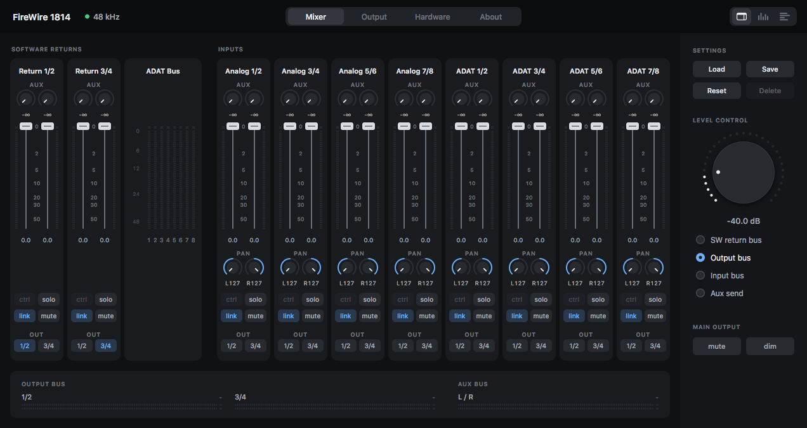</p>

> **Who this is for.** Only people who own an **M-Audio FireWire 1814, FireWire Audiophile or FireWire 410**. It does nothing without the interface. The original M-Audio software belongs to M-Audio / inMusic — see [`NOTICE.md`](NOTICE.md).

> **Homebrew and experimental.** A hobby project, not a product: the kernel extension is **unsigned and will stay unsigned**, so it runs only with **System Integrity Protection disabled**, and nothing is promised or supported.

> **Status: package 0.4.0** (driver 0.3.0, panel 1.6; see [`CHANGELOG.md`](openaudio-mafw-bebob/CHANGELOG.md)) adds the **FireWire 410** (released 2026-10-27 as [v0.4.0](https://github.com/bhsardinha/OA-BeBoB-MAFW/releases/tag/v0.4.0)).
> - **Classic** (macOS 10.13 to 10.15): the **FireWire 410** was brought up and checked on an **iMac (iMac11,2, native FireWire 800, macOS 10.13.6)** with package 0.4.0, installed from its package. The **FireWire 1814 and FireWire Audiophile** were tested alone and together on that iMac, and on a MacBook Air (MacBookAir5,1) through Apple's Thunderbolt-to-FireWire adapter, with packages up to 0.2.2; they have **not yet been re-tested on 0.4.0**, which changes code they share with the 410.
> - **Modern** (macOS 11 to 15, Intel): tested with **0.3.1** on a **MacBook Air (MacBookAir7,2), macOS 14.8.9**, with the Audiophile (plays) and a FireWire 1814 (panel and external-rate follow). The 0.4.0 Modern package has **not been tried** yet; the FireWire 410 has never run on Modern.
>
> Nothing else has been tested. Read [Known issues](#known-issues) before installing.

## The three interfaces

| | **FireWire 1814** | **FireWire Audiophile** | **FireWire 410** |
|---|---|---|---|
| Channels | 18 in / 14 out (ADAT mode), 10 in / 6 out (S/PDIF mode) | 4 in / 6 out | 4 in / 10 out |
| Sample rates | 44.1 to 192 kHz | 44.1 to 96 kHz | 44.1 to 192 kHz |
| At 176.4 / 192 kHz | 2 in / 4 out, analog only | — | **2 in / 8 out**: all eight analog outputs stream |
| Digital I/O | ADAT or S/PDIF (optical), coaxial S/PDIF, word clock | coaxial S/PDIF | S/PDIF, coaxial **or** optical input (output on both) |
| Mixer | register mixer, aux bus, two phones outputs with A/B | AV/C mixer, aux bus, phones with A/B switch | register mixer, aux bus, phones from **any combination** of the output buses and the aux bus |
| Front panel | Level Controller, phones knobs, A/B | Level Controller, phones knob, A/B switch and LEDs | Level Controller (assignable to five buses) |
| MIDI | 1 in / 1 out | 1 in / 1 out | 1 in / 1 out |
| Since | 0.1.0 | 0.2.0 | **0.4.0** |

Each interface has its own panel layout, drawn from the official panel's controls ([screenshots](#screenshots)). The driver is one kernel extension: a shared base plus one small module per model, structured like the official driver's class family ([`docs/ARCHITECTURE_MAFW_v1.md`](docs/ARCHITECTURE_MAFW_v1.md)).

## Screenshots

<table>
<tr>
<td align="center">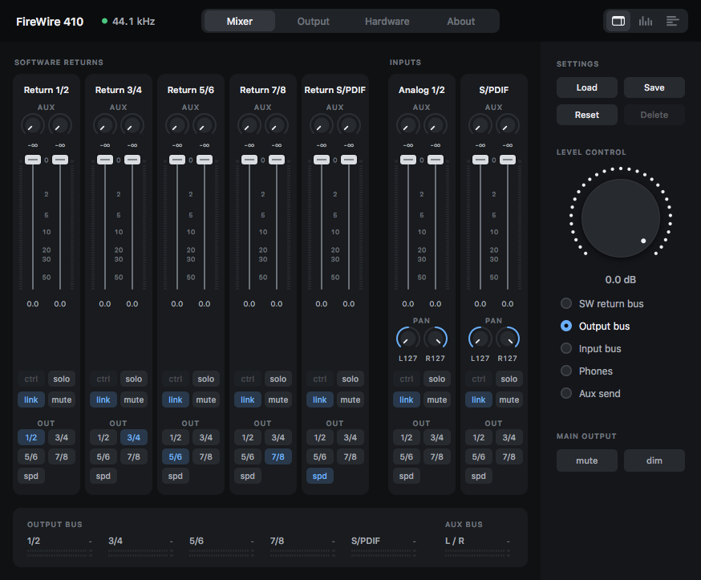<br><sub>FireWire 410: mixer (connected to the interface)</sub></td>
<td align="center">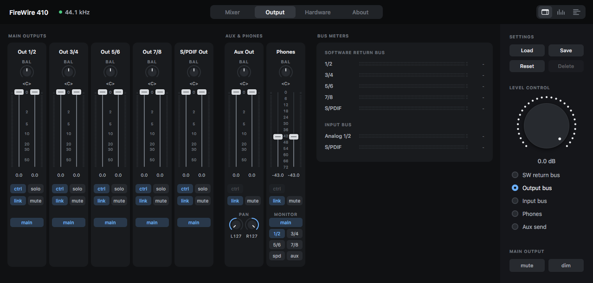<br><sub>FireWire 410: output page (phones with main/aux and six sources)</sub></td>
</tr>
<tr>
<td align="center">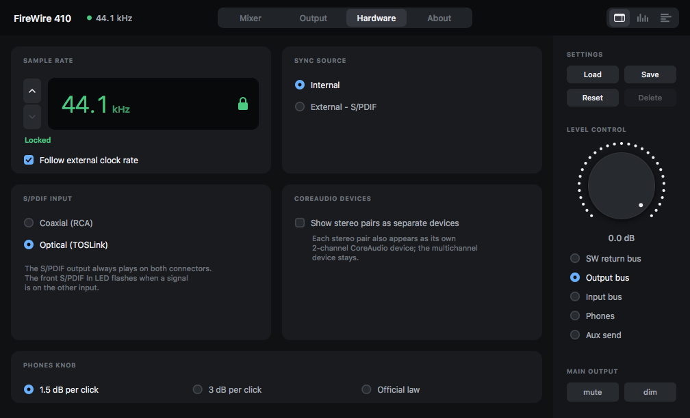<br><sub>FireWire 410: hardware page (S/PDIF input, CoreAudio devices)</sub></td>
<td align="center">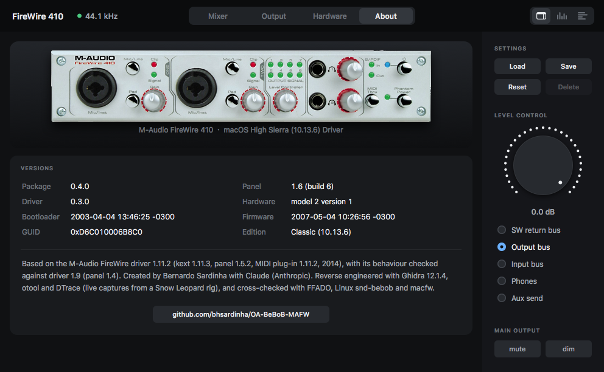<br><sub>FireWire 410: about page</sub></td>
</tr>
<tr>
<td align="center">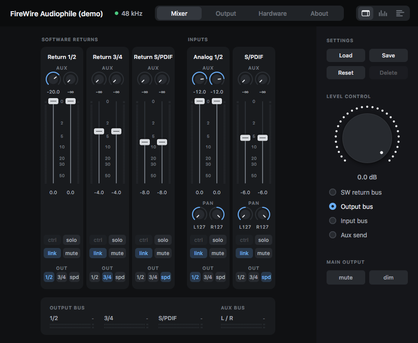<br><sub>FireWire Audiophile: mixer (demo mode render)</sub></td>
<td align="center">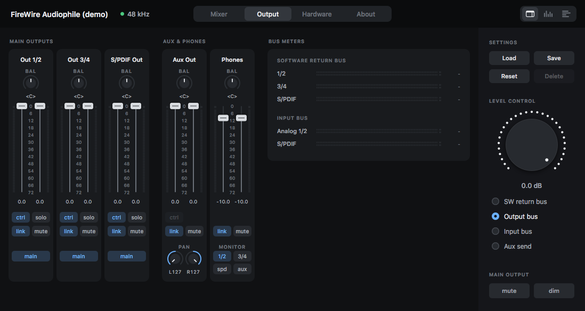<br><sub>FireWire Audiophile: output page</sub></td>
</tr>
<tr>
<td align="center">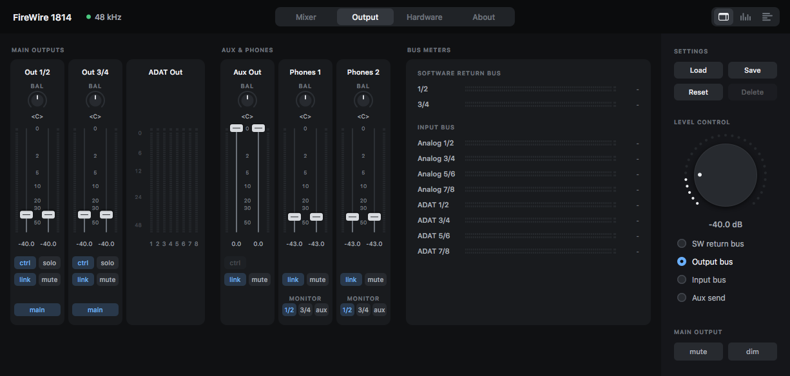<br><sub>FireWire 1814: output page</sub></td>
<td align="center">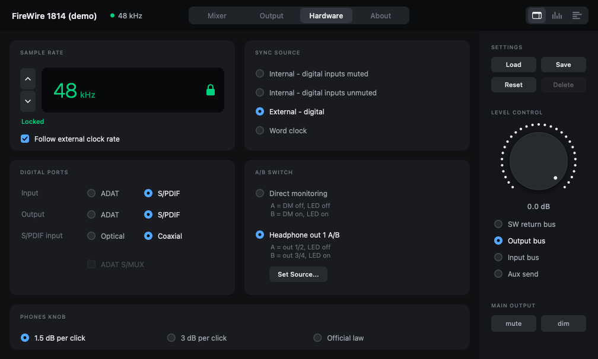<br><sub>FireWire 1814: hardware page (rate with <i>Follow external clock rate</i>, sync, digital ports, A/B switch, phones knob; demo mode render, 0.3.1)</sub></td>
</tr>
<tr>
<td align="center">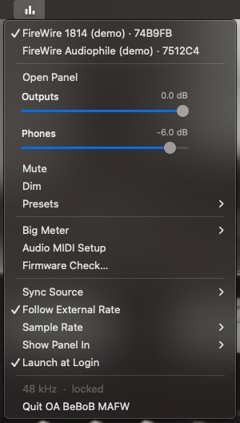<br><sub>Status menu (the panel's demo mode on a MacBook Air)</sub></td>
<td align="center">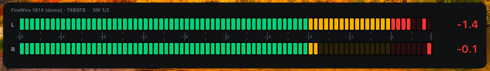<br><sub>Big meter (the panel's demo mode on a MacBook Air)</sub></td>
</tr>
</table>

What each view does is under [Panel features](#panel-features).

---

## Compatibility

Two editions, one source tree. Download the `.dmg` of your edition; each installer accepts only its own macOS range.

| | **Classic** | **Modern** |
|---|---|---|
| **Download** | `…-classic.dmg` | `…-modern.dmg` |
| **macOS** | **10.13 High Sierra to 10.15 Catalina** | **11 Big Sur to 15 Sequoia**, Intel only¹ |
| **Tested on** | macOS **10.13.6**: iMac11,2 with native FireWire 800; MacBook Air (MacBookAir5,1) through Apple's **Thunderbolt-to-FireWire adapter**. 10.14 / 10.15, other Macs and adapters untested | macOS **14.8.9**: MacBook Air (MacBookAir7,2) through the same kind of adapter. 11, 12, 13, 15 and other Macs untested; no Apple Silicon |
| **Built with** | 10.13 SDK, Xcode 9.4.1 (64-bit kext) | macOS 15.2 SDK |
| **Interfaces tried** | **FireWire 1814 and FireWire Audiophile**, alone and together (up to 0.2.2); **FireWire 410** alone (0.4.0, iMac) | The **FireWire Audiophile** plays; the **FireWire 1814** for the panel and the external-rate follow only (0.3.1); the **FireWire 410** not tried |
| **Security** | **Unsigned, always**; **System Integrity Protection must be disabled** (Recovery, `csrutil disable`) | Unsigned, always; SIP set so unsigned kexts load, then **Allow** in System Settings › Privacy & Security (shown as *unidentified developer*) and a restart |

¹ Does not work on macOS 26 Tahoe.

- **Other models of the official driver** (FireWire Solo, Ozonic, ProFire Lightbridge, ProjectMix I/O, NRV10): not implemented; the structure for them exists (see [Roadmap](#roadmap)).
- **Apple Silicon:** an idea, not started.
- **Mac OS X 10.6.8 to 10.8.5:** out of scope; the official M-Audio drivers work there.
- **More detail:** what differs between the editions, and what is tested on each, is in [`docs/EDITIONS.md`](docs/EDITIONS.md); see also the [compatibility plan](docs/compatibility/BROAD_COMPATIBILITY_PLAN_v4.md).

## What is in the package

- **Kernel extension** (`com.openaudio.OpenAudioBeBoBMAFW`): matches the interfaces on the FireWire bus, brings them up (AV/C, CMP, isochronous streams with classic DCL programs) and publishes a CoreAudio device per unit with the hardware mixer properties, peak meters and MIDI ports. One driver for all three models: a shared base plus one module per model.
- **Helper daemon** (LaunchDaemon): starts the interface firmware after power-up (the interfaces wait in their bootloader until told to start) and remembers your settings per unit, replaying them when the driver attaches. A unit with no saved settings gets its headphone level lowered to −43 dB. It never writes the interface's flash.
- **Control panel** (`OA BeBoB MAFW.app`): mixer, output, hardware and meter views for each model, presets, level knob, a device menu for several units, an optional **menu bar mode** with a status menu, a segmented **big meter**, and a read-only **firmware check** (is each unit running the official 1.11.2 firmware of its model?). It talks to the driver through registry properties, like the original panel.
- **MIDI:** the original M-Audio CoreMIDI plug-in, reused **unmodified**.
- **Installer:** `Install OA BeBoB MAFW.pkg`, a one-window **Uninstall OA BeBoB MAFW** app and a `.dmg` holding both. It **updates any earlier version in place** (0.1.0, 0.2.x or 0.3.x, no manual uninstall; settings kept) and asks for a restart; nothing is unloaded while it runs.

## What works (checked on the interfaces)

### FireWire 1814 (up to 0.3.1)

- **All six rates.**
- **ADAT mode:** 16 in / 12 out.
- **S/PDIF mode:** 10 in / 6 out.
- **176.4 / 192 kHz:** 2 in / 4 out analog; the digital ports are off at those rates (a hardware limit).
- **Panel, saved settings and the MIDI plug-in** work.
- **Real round-trip latency 9.3 ms at 48 kHz / 64 frames** (analog loopback).

### FireWire Audiophile (up to 0.3.1)

- **4 in / 6 out at 44.1 / 48 / 88.2 / 96 kHz**; channel order confirmed with a tone per channel and the device's own meters.
- **Round-trip latency 9.1 ms at 48 kHz / 64 frames** (analog loopback), matching what the driver reports.
- **Panel:** three software-return strips, two input strips, aux bus, outputs, phones, routing, sync, headphone A/B source matrix.
- **Factory reset:** gives exactly the official driver's factory state.
- **Front panel:** Level Controller, headphone knob, A/B switch and its LEDs.
- **MIDI:** the M-Audio plug-in lists the Audiophile, 1 in / 1 out.
- **Settings** survive a driver reload.

### FireWire 410 (0.4.0, Classic, iMac, alone on the bus)

Checked with a tone on one channel at a time and the interface's own output meters, a loopback cable, and by ear where noted.

- **Comes up by itself** after power-up (the helper starts the firmware) and after a driver reload; settings are saved and replayed per unit.
- **4 in / 10 out at 44.1 to 96 kHz:** each output channel reaches its own output, at the same level as with the official driver.
- **2 in / 8 out at 176.4 / 192 kHz:** all eight analog outputs stream (the interface's early manual says only outputs 1 and 2; the 2007 firmware and the official 1.11.2 driver use all eight). Recording works at every rate, 192 kHz included.
- **Round-trip latency 8.5 ms at 48 kHz / 64 frames** (analog loopback, out 3 → in 1); the latency the driver reports to CoreAudio is within 0.5 ms of the measured one at every rate.
- **Mixer:** software-return and input routing to **one or several outputs at once**, levels, mute, solo, aux sends and aux bus, phones source from any combination of the five output buses (and, new, the aux bus), output levels (by meter) and the phones level (by ear).
- **Front panel:** the Level Controller follows its assignment in the panel (software returns, outputs, inputs, phones or aux send).
- **Stereo pairs as separate devices** (see below): the same five CoreAudio devices as the official driver, each playing on its own outputs.
- **Not tried yet:** MIDI, S/PDIF in/out with an external clock, the coaxial/optical switch, sleep/wake, two units on one bus, the Modern edition.

### Both of the older units on one bus

- **The FireWire 1814 and the FireWire Audiophile** come up and stream together, recover after a power-cycle, and the panel switches between them (0.2.x).

## Panel features

### Stereo pairs as separate CoreAudio devices (new in 0.4.0)

- **What it does:** besides the multichannel device, each stereo pair of the interface also appears as its own 2-channel CoreAudio device — for applications that use only the first two channels of a device, or to send different programs to different outputs. The multichannel device stays.
- **Where:** **Show stereo pairs as separate devices** on the Hardware page, card *CoreAudio Devices*, for every model (the official 1.9 panel shows it for the FireWire 410, not for the FireWire 1814).
- **FireWire 410:** *Analog 1/2* (in and out), *S/PDIF 1/2* (in and out), *Analog 3/4 Out*, *5/6 Out*, *7/8 Out* — names and device IDs identical to the official driver, so applications see the same devices.
- **Tried** on the FireWire 410 only; on the FireWire 1814 (whose pairs change with the ADAT / S/PDIF mode) and the Audiophile it is untested.

### Follow the external clock rate (new in 0.3.1)

- **What it does:** with the sync source on **External – digital** (S/PDIF), the panel sets the interface to the **source's sample rate by itself**.
- **How it finds the rate:** the interface reports the source's exact rate only while the source is in its current speed range (44.1 / 48 or 88.2 / 96 kHz); when it sees nothing, the panel tries the other range once and goes back if nothing locks there.
- **Only while nothing plays:** it changes the rate only while no application plays through the interface; otherwise it shows *Source at 44.1 kHz - follows when playback stops* and waits.
- **Setting:** **Follow external clock rate** on the Hardware page (and *Follow External Rate* in the status menu), on by default; it also works with the panel hidden or launched at login.
- **Tested** on the Modern edition with a FireWire 1814 and a Line 6 POD X3 on coaxial S/PDIF.
- **Not followed:** word clock.
- **Untried:** optical S/PDIF, ADAT, the Audiophile, the FireWire 410 and the Classic edition.
- **The official driver** detects the source's rate the same way but never follows it.

### Status menu (new in 0.2)

- **Where the panel lives:** the **menu bar**, the **Dock**, or both, and it can **launch at login** (choose under *Show Panel In*).
- **Icon:** shows the selected interface at a glance — **online**, **muted** or **not locked** (no sync), dimmed when no interface is connected.
- **Click:** opens the panel.
- **Right click** (or control-click): opens the menu, which acts on the unit checked at the top (the list appears only with several units).
- **Levels and presets:** Open Panel, outputs and phones volume sliders (each on its fader's law), mute, dim, presets that fit that interface.
- **Tools:** the big meter, Audio MIDI Setup and the firmware check.
- **Clock and startup:** sync source, Follow External Rate, sample rate (greyed while an application streams), *Show Panel In*, *Launch at Login*.
- **Status:** the rate and lock state (and the external source's rate when the panel is waiting to follow it).

### Big meter (new in 0.2)

- **Look:** a horizontal peak meter about 80 % of the screen wide, segmented like an old stereo deck.
- **Scale:** **80 LED blocks over −60 … 0 dBFS** (0.75 dB each); green up to −18, amber up to −6, red above; unlit blocks faintly visible.
- **Peak hold:** a hold block (about 2 s), plus large peak readouts.
- **Source:** SW 1/2 (default), Out 1/2, Phones or In 1/2 of the selected unit.
- **Window options** (right-click it, or use the status menu): always on top; pin to the top or bottom of the screen, or move it freely; transparent; click-through.
- **Toggle:** *View › Big Meter* (⌘B).
- **Peak only,** from the driver's meter page — no RMS or loudness.

### Phones level law (this project's choice, not the official one)

- **Phones faders:** dB-linear over 72 dB (centre = −36 dB, bottom = off).
- **Phones knob:** 1.5 dB per click by default; 3 dB or the official law selectable per unit.
- **Outputs, aux out and the mixer:** the official console law.
- **Knobs on the outputs:** move them with the official law.

### Light on the CPU

- **Meters:** GPU-composited layers, redrawn only when a segment changes (the official panel's method).
- **CPU use:** with moving meters the panel uses about 2 % of a core on a 2010 iMac.

---

## Install

1. Download the `.dmg` of your edition from the [Releases](https://github.com/bhsardinha/OA-BeBoB-MAFW/releases) page: `…-classic.dmg` for macOS 10.13 to 10.15, `…-modern.dmg` for macOS 11 to 15 on Intel.
2. Quit audio and MIDI applications. Remove the official M-Audio (and Avid/DICE) FireWire drivers first; they conflict. An earlier OpenAudio version does **not** need to be removed: the installer replaces it and keeps your settings.
3. Set the security level: **Classic** needs System Integrity Protection disabled (Recovery mode, `csrutil disable`); **Modern** needs SIP set so unsigned kexts load.
4. Open the `.dmg`, run **Install OA BeBoB MAFW.pkg**. (The package contains M-Audio's CoreMIDI plug-in unmodified, so that MIDI works; see [`NOTICE.md`](NOTICE.md).)
5. **Modern only:** when the installer says so, open System Settings › Privacy & Security and press **Allow** (the developer shows as *unidentified*, because the driver is unsigned).
6. **Restart**, power on the interface. It appears in Audio MIDI Setup; the panel **OA BeBoB MAFW** is in `/Applications`.

- **macOS check:** each installer refuses a macOS outside its range; the Modern one also removes the driver, failing the install, if this Mac lacks a kernel symbol it needs.
- **Uninstall:** to remove everything, run **Uninstall OA BeBoB MAFW** from the disk image and restart.

## What does not work

Three different reasons, kept apart on purpose.

### Impossible (by hardware, by the OS, or by design)

- **macOS 26 Tahoe and later:** no FireWire stack to attach to. This is another project's finding ([macfw](https://github.com/mbprado/macfw) states Apple removed it); it has not been checked here.
- **Apple Silicon with the kernel driver, today:** not buildable as it stands: the driver has no arm64e build, and M-Audio's MIDI plug-in has no arm64 code. The FireWire and IOAudio kernel families do ship for arm64e (read from Apple's debug kit), but FireWire through the adapter chain has never been tried on such a Mac, so this is *not developed* rather than proven impossible.
- **Macs with SIP enabled, or a signed or notarised driver:** the driver is unsigned and will stay unsigned (the author's decision), so it only loads with SIP set to allow unsigned kexts.
- **A Mac with no FireWire port and no adapter:** the interfaces are FireWire only. Newer Macs need Apple's Thunderbolt-to-FireWire adapter (and a Thunderbolt-3-to-2 adapter on the newest ones); only the Thunderbolt 2 adapter chain has been tried.
- **FireWire 1814 at 176.4 / 192 kHz: digital ports and the DSP mixer:** switched off by the hardware at those rates: 2 in / 4 out analog only.
- **FireWire 410: its power LED lights or blinks while the unit is switched off** but cabled to a running Mac. That is the interface's low-power mode, in which it keeps passing FireWire through to its second port (manual p.7); the firmware is not running then, so no driver or firmware can change it. A FireWire connection without bus power (a 4-pin cable, with the 410's own power supply) should keep it dark — not tried.
- **ASIO and a driver-side buffer size:** Windows-only features of the official driver; on macOS the buffer size belongs to the application.

### Not developed (yet)

- **OS X 10.9 to macOS 10.12:** in scope but not done: the Classic installer starts at 10.13.
- **Apple Silicon:** see above; it would also need a new MIDI plug-in. Needs the hardware to start.
- **Other M-Audio BeBoB interfaces** (FireWire Solo, Ozonic, ProFire Lightbridge, ProjectMix I/O, NRV10): the code is structured for one module per model (the FireWire 410 was added that way in 0.4.0), but nothing is implemented for them. It needs people who own the hardware.
- **Interfaces from other makers** (including DICE-based ones): out of scope.
- **Firmware update from the panel:** the panel's firmware check only reads. Nothing writes the interface's flash, and there is no custom firmware.
- **Following the rate of a word-clock source:** only *External – digital* is followed (0.3.1); with word clock you set the rate yourself.
- **Mac OS X 10.6.8 to 10.8.5:** out of scope (decided 2026-10-22): the official M-Audio drivers work well there, so this project starts at 10.9.
- **Windows and Linux:** not this project (Linux has FFADO and snd-bebob).

### Written but not tried

These exist in the driver, but nobody has run them, so do not count on them:

- **macOS 10.14 and 10.15** (allowed by the Classic installer).
- **macOS 11, 12, 13 and 15** (allowed by the Modern installer).
- **The 0.4.0 Modern package** (any interface), and the **FireWire 410 on Modern**.
- **The FireWire 1814 and the Audiophile on 0.4.0** (it changed shared code: channel maps, the unload path, the CoreAudio device IDs of the stereo-pair devices).
- **The FireWire 1814 on the Modern edition** beyond the panel and the external-rate follow (playback, recording, MIDI).
- **Stereo pairs as separate devices** on the FireWire 1814 and the Audiophile.
- **FireWire 410:** MIDI, S/PDIF and external sync, the coaxial/optical switch, sleep/wake.
- **The external-rate follow** with optical S/PDIF, ADAT, the Audiophile, the FireWire 410 or on the Classic edition.
- **MIDI SysEx on the wire.**
- **AC-3 pass-through on the wire.**
- **Two FireWire 1814s on one bus; the FireWire 410 together with another unit.**
- **FireWire 400 and Macs other than those listed under [Compatibility](#compatibility).**

## Known issues

1. **Do not change the rate or the digital mode while audio is playing.** The original driver panics there; this driver gates only the panel's own rate change. Stop playback first.
2. **Unloading the driver** (`kextunload`) **is safe from 0.4.0 on.** Earlier versions left a FireWire plug registered when they were unloaded, idle or playing, and the next bus reset — switching an interface off, for example — made the Mac panic (found 2026-10-26 with the FireWire 410; the same as a 0.1.0 panic in 2026-10). 0.4.0 frees it when the driver stops and was checked with unloads while idle and while playing, and with a power-cycle afterwards. With an older version, **restart instead of unloading**; the installer and uninstaller never unload anyway.
3. **Front-panel knobs can lose clicks on fast turns** — the interface reports only a direction per read (about every 50 ms), as with the official driver.
4. **FW1814: the Audio MIDI Setup sidebar label can be stale** after an S/PDIF ↔ ADAT switch (the real channel counts are correct), and the switch interrupts audio for about 4 s.
5. **The external-rate follow waits while audio plays** (by design: see item 1). A source outside the interface's speed range takes several seconds to be found (one try of the other range). Word clock is not followed. With *Follow external clock rate* off, set the source's rate yourself, as before 0.3.1.
6. **Sleep and wake.** 0.3.1 could freeze the Mac (kernel panic) on wake from sleep if the interface dropped off the FireWire bus while the Mac slept (found 2026-10-22, Modern, FireWire 1814); fixed from driver 0.2.3, so in 0.4.0. After a sleep in which the interface lost power, the mixer comes back, but some routing (the phones source on the 1814, the S/PDIF input pans) may need to be set again in the panel. Sleep/wake with the FireWire 410 has not been tried.
7. **Not tested** (no formal test plan; these get looked at if someone hits a problem): MIDI bytes on the wire and SysEx, AC-3 pass-through on the wire, streaming for hours, two FW1814s on one bus, the full 0.1.0 test ladder of the FW1814 on the new driver. Updating in place, the Uninstall app and the status menu have been used on a real install.
8. **No firmware update.** The driver starts the firmware already in the interface; the panel's firmware check only reads it. Nothing writes flash.
9. **FW1814 at 176.4 / 192 kHz:** digital ports and the DSP mixer are off (hardware); a loopback of analog inputs at 192 kHz read silence once, unexplained.
10. **Rough edges:** diagnostic logging is still compiled in; English only.

## Roadmap

- **Other M-Audio BeBoB interfaces.** Each is a model module (tables, mixer map, status decode) on the shared base — [`docs/ARCHITECTURE_MAFW_v1.md`](docs/ARCHITECTURE_MAFW_v1.md) has the checklist, and the FireWire 410 ([`docs/BUILD_FW410_PLAN_v2.md`](docs/BUILD_FW410_PLAN_v2.md)) is the latest worked example. It needs people who own the hardware: captures, issues and pull requests are welcome.
- **A guide for building the panel on other systems.**

---

## Build from source

You need **macOS 10.13.6 with Xcode 9.4.1** (the last Xcode with the 10.13 SDK).

```sh
cd openaudio-mafw-bebob
make -C kext                 # kext/build/OpenAudioBeBoBMAFW.kext
make -C firmware-helper      # firmware-helper/build/oa-fwhelper
make -C control-panel app    # control-panel/build/OA BeBoB MAFW.app   (make -C control-panel test: logic tests)
scripts/stage-kext.sh        # copy to /tmp and run kextutil -t -n (static check; loads nothing)
tests/host/run.sh            # host tests of the kernel-free parts (frames, tables, mixer maps, converters)
```

- **Never copy an untested kext into `/Library/Extensions`** (a panicking kext there boot-loops).
- **Modern edition:** the kext is built on a macOS 14/15 Mac with the 15.2 SDK (`make -C kext BAND=modern`); see [`docs/EDITIONS.md`](docs/EDITIONS.md).
- **Installer:** it also needs M-Audio's `MAudioFireWireMIDI.plugin` from your own copy of the official 1.11.2 installer, placed in `openaudio-mafw-bebob/installer/assets/` (see the README there); `installer/make-dmg.sh` builds the package and the disk image.
- **Version numbers:** the package has its own number (`VERSION`), the driver and the panel keep theirs (see the top of [`CHANGELOG.md`](openaudio-mafw-bebob/CHANGELOG.md)).
- **Bench tools:** described in [`openaudio-mafw-bebob/tools/README.md`](openaudio-mafw-bebob/tools/README.md).

## Repository map

| Path | What |
|---|---|
| [`openaudio-mafw-bebob/`](openaudio-mafw-bebob/) | **Current code (0.4.x):** `kext/` (`src/base/` + `src/models/FW1814`, `FWAudiophile`, `FW410`), `firmware-helper/`, `control-panel/` (`Sources/Models/<Model>/`), `installer/`, `tools/`, `tests/`, `scripts/`, `CHANGELOG.md`, `VERSION` |
| [`openaudio-fw1814/`](openaudio-fw1814/) | The 0.1.0 tree (FireWire 1814 only), kept as released (tag `v0.1.0`); its `tools/` hold the bench tools |
| [`docs/system-map/`](docs/system-map/README.md) | Reverse-engineering notes: class chain, DCL rings, clocking, AV/C and HSCI commands, mixer model, panel, MIDI plug-in, helper, captures |
| [`docs/system-map/PROVENANCE-RESOLUTIONS.md`](docs/system-map/PROVENANCE-RESOLUTIONS.md) | Dated log of every finding, correction and test result (R1 … R140) |
| [`docs/ARCHITECTURE_MAFW_v1.md`](docs/ARCHITECTURE_MAFW_v1.md) | Driver layers and how a model plugs in |
| [`docs/BUILD_AUDIOPHILE_PLAN_v9.md`](docs/BUILD_AUDIOPHILE_PLAN_v9.md), [`docs/BUILD_FW410_PLAN_v2.md`](docs/BUILD_FW410_PLAN_v2.md) | The plans for the Audiophile (0.2) and the FireWire 410 (0.4) |
| [`docs/fw410-manual-reference.md`](docs/fw410-manual-reference.md), [`docs/audiophile-manual-reference.md`](docs/audiophile-manual-reference.md), [`docs/manual-reference.md`](docs/manual-reference.md) | Developer notes on each interface's manual, against the driver |
| [`docs/EDITIONS.md`](docs/EDITIONS.md), [compatibility plan](docs/compatibility/BROAD_COMPATIBILITY_PLAN_v4.md) | Classic vs Modern edition: what differs and what is tested; the plan for macOS 10.9 to 15 |
| [`docs/STATE.md`](docs/STATE.md), [`NEXT_STEPS.md`](docs/project/NEXT_STEPS.md) | Current state and what is next |
| `PROVENANCE-MATRIX*.xlsx` | Project trackers (tasks, per-claim evidence, dashboards; in Portuguese) |

## How it was made

Everything the driver does is traced to evidence: the official 2014 driver (kext, panel, MIDI plug-in, helper, firmware loader) analysed with **Ghidra** and `otool`, plus live **DTrace**, `ioreg` and FCP captures from a Snow Leopard Mac running the official driver against all three interfaces. The wire protocol was cross-checked with [FFADO](https://github.com/ojsl1/libffado), the Linux [snd-bebob](https://github.com/torvalds/linux/tree/master/sound/firewire/bebob) driver, [snd-firewire-ctl-services](https://github.com/alsa-project/snd-firewire-ctl-services) and [macfw](https://github.com/mbprado/macfw). Where the original and the 10.13 kernel disagree, the original is mirrored and the difference is commented in the code with what forced it.

Created by Bernardo Sardinha, with Claude (Anthropic).

## Acknowledgements, ownership and license

The original M-Audio FireWire software and firmware, the device icons and product photographs are the property of **M-Audio / inMusic Brands, Inc.** and their licensors (firmware: BridgeCo); this project claims no rights in them and acknowledges them gratefully. It is an independent, **non-commercial** effort for owners of M-Audio FireWire hardware only, and it is not affiliated with or endorsed by M-Audio, inMusic, Avid, Apple or BridgeCo. Details of what M-Audio material appears here, and what does not, are in [`NOTICE.md`](NOTICE.md).

Thanks to the open projects that documented the protocol: [FFADO](https://github.com/ojsl1/libffado), the Linux [snd-bebob](https://github.com/torvalds/linux/tree/master/sound/firewire/bebob) driver, [snd-firewire-ctl-services](https://github.com/alsa-project/snd-firewire-ctl-services) and [macfw](https://github.com/mbprado/macfw).

**License:** [PolyForm Noncommercial 1.0.0](LICENSE) — free to use, change and share for personal and non-profit purposes; commercial use is not permitted. The license covers this project's own work, not M-Audio's material.
