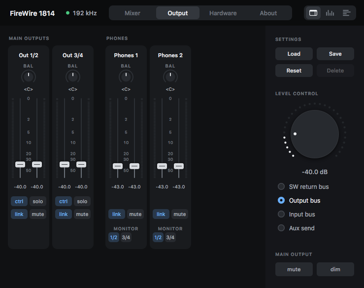
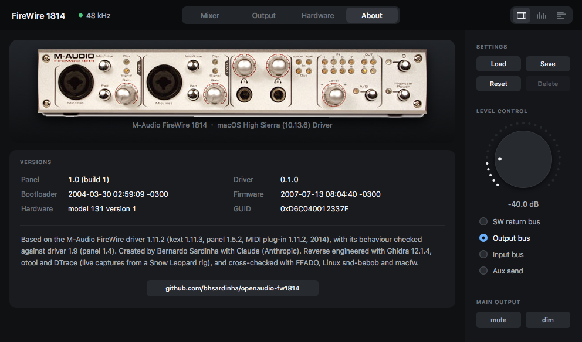
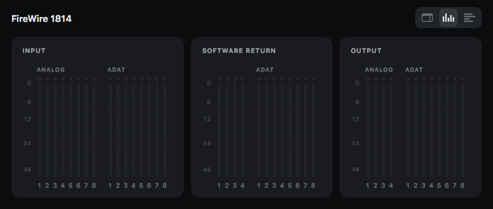

# OpenAudio FW1814

**A native driver, control panel and installer for the M-Audio FireWire 1814 on macOS 10.13.6 High Sierra.**

The FireWire 1814 is a 18-in / 14-out FireWire audio interface (BridgeCo BeBoB / DM1000) that M-Audio stopped supporting years ago. The last official driver (1.11.x, 2014) kernel-panics on macOS 10.13.6 as soon as the interface is attached, and its Carbon control panel is 32-bit only. OpenAudio FW1814 is a from-scratch replacement: a 64-bit kernel extension, a helper daemon, a modern AppKit control panel and an installer, built by reverse engineering the official driver and checking every behaviour against the real hardware.

<p align="center"></p>

> **Who this is for.** Only people who own an **M-Audio FireWire 1814** (and, one day, other M-Audio FireWire interfaces). M-Audio ended support for these interfaces more than a decade ago and their last driver does not work on current macOS; this project exists solely to keep that hardware usable. It does nothing without the interface. The original M-Audio software belongs to M-Audio / inMusic — see [`NOTICE.md`](NOTICE.md).

> **Status: early, working, 1814-only.** This is version 0.1.0 (tag `v0.1.0-first-working-2026-10-17`). It plays and records audio, the panel controls the interface and the original M-Audio MIDI plug-in loads. It has been tested on **one FireWire 1814, on one Mac running macOS 10.13.6, with System Integrity Protection disabled**. Nothing else has been tested. Please read [Known issues](#known-issues) before installing it.

---

## What it is

| Component | What it does |
|---|---|
| **Kernel extension** (`com.openaudio.OpenAudioFW1814`) | Matches the interface on the FireWire bus, brings it up (AV/C, CMP, isochronous streams with classic DCL programs), publishes a CoreAudio device (`FireWire 1814 Multichannel`) with all channels at 44.1 – 192 kHz, the hardware mixer properties, peak meters and the MIDI ports. |
| **Helper daemon** (LaunchDaemon) | Starts the interface firmware after power-up and remembers your settings (levels, routing, clock) per interface, replaying them when the driver attaches. It never writes the interface's flash. |
| **Control panel** (`OpenAudio FW1814.app`) | Mixer, output, hardware and meter views, presets, level-control knob. Talks to the kext through registry properties, like the original panel. |
| **MIDI** | The original M-Audio CoreMIDI plug-in is reused **unmodified**; the kext provides what it expects. |
| **Installer** | `.pkg` (kext, helper, panel, MIDI plug-in, icons), a one-window **Uninstall** app and a `.dmg` that holds both. |

### What works (checked on the interface)
- **Audio through Core Audio** in Studio One, Audio MIDI Setup and reAMP: 16 in / 12 out in ADAT mode, 10 in / 6 out in S/PDIF mode, 2 in / 4 out analog at 176.4 and 192 kHz (the digital ports are off at those rates — a hardware limit).
- **Real round-trip latency 9.3 ms at 48 kHz / 64 frames** (measured with an analog loopback; it matches what the driver reports). The same measurement tool runs against the original driver on a Snow Leopard machine for comparison.
- **Rates** 44.1 / 48 / 88.2 / 96 / 176.4 / 192 kHz, changed from the panel or any Core Audio app; S/PDIF ↔ ADAT switching with the stream resuming by itself after about 4 s.
- **Panel**: faders, pan, aux sends, mute/solo/link, routing, A/B switch, headphone sources, clock source and digital ports, ADAT S/MUX, main level knob, presets, live meters, saved settings.
- **MIDI**: the M-Audio plug-in loads in `MIDIServer` and lists the FireWire 1814 ports with its device icon.
- **Core Audio controls** in Audio MIDI Setup: per-channel volume/mute and the "Thru" controls, as the older 1.9 driver exposed them.

<table>
<tr>
<td align="center"><br><sub>Output page (outputs, aux out, phones)</sub></td>
<td align="center"><br><sub>Hardware page (rate, sync, digital ports, A/B switch)</sub></td>
</tr>
<tr>
<td align="center"><br><sub>At 176.4/192 kHz: outputs and phones only (the DSP mixer is off)</sub></td>
<td align="center"><br><sub>About page</sub></td>
</tr>
<tr>
<td align="center"><br><sub>Meter window</sub></td>
</tr>
</table>

---

## Compatibility

| | |
|---|---|
| **Interface** | **M-Audio FireWire 1814 only.** It is the only hardware the author owns, so it is the only one that has been tested. The code is written so other BeBoB-based M-Audio devices could be added (see [Roadmap](#roadmap)), but none is implemented. |
| **macOS** | **10.13.6 High Sierra only** (64-bit kext, 10.13 SDK, Xcode 9.4.1). Other versions are untested and almost certainly unsupported. |
| **Mac** | Tested on an iMac (iMac11,2) with a native FireWire 800 port. FireWire 400 and Thunderbolt/Apple adapters are untested. |
| **Security** | The kext is **not signed with a Developer ID** and has only been tested with **SIP disabled**. See below. |

## Install

1. Quit audio and MIDI applications. Remove the official M-Audio (and Avid/DICE) FireWire drivers first; they conflict.
2. Open the `.dmg`, run **Install OpenAudio FW1814.pkg**, restart. (The released package contains M-Audio's CoreMIDI plug-in unmodified, so that MIDI works; see [`NOTICE.md`](NOTICE.md).)
3. If macOS blocks the extension, allow it in *System Preferences ▸ Security & Privacy*. Whether an unsigned kext can be approved at all with SIP enabled has not been tested; the author's test Mac has SIP disabled.
4. Power on the 1814. It appears as **FireWire 1814 Multichannel** in Audio MIDI Setup; the panel is in `/Applications`.

To remove everything run **Uninstall OpenAudio FW1814** from the disk image (it asks for your administrator password).

## Build from source

You need a Mac running **10.13.6 with Xcode 9.4.1** (the last Xcode with the 10.13 SDK; newer toolchains cannot build the kext).

```sh
cd openaudio-fw1814
make -C kext                 # kext/build/OpenAudioFW1814.kext
make -C firmware-helper      # firmware-helper/build/oa-fwhelper
make -C control-panel app    # control-panel/build/OpenAudio FW1814.app   (make -C control-panel test: logic tests)
scripts/stage-kext.sh        # copy to /tmp and run kextutil -t -n (static check; loads nothing)
```

Never copy an untested kext into `/Library/Extensions` (a panicking kext there boot-loops). Load a staged copy with `kextutil` and keep `sudo dmesg` handy.

The installer additionally needs the **M-Audio CoreMIDI plug-in** (`MAudioFireWireMIDI.plugin`) from your own copy of the official M-Audio FireWire 1.11.2 installer, placed in `openaudio-fw1814/installer/assets/` (see the README there). It is M-Audio's file and is not part of this repository; the device icons it uses are included. `installer/make-pkg.sh` builds the package; `installer/make-dmg.sh` builds the disk image (needs `installer/.venv`, see `installer/requirements.txt`).

Bench tools (latency loopback, CoreAudio rate walker, MIDI probe, …) are described in [`openaudio-fw1814/tools/README.md`](openaudio-fw1814/tools/README.md).

---

## Known issues

These are real, observed or expected, and ordered roughly by how much they matter.

1. **Kernel panic seen once during playback.** On 2026-10-17 the kernel panicked inside Apple's IOAudioFamily (`IOAudioStream::mixOutputSamples`, reached from `coreaudiod`) while Studio One was playing at 48 kHz / 64 frames. The report is in [`docs/system-map/build-pc-panics/`](docs/system-map/build-pc-panics/). The cause is not proven; the likely reason is a stale stream format after a rate change, which was found and fixed the same day — but nobody has confirmed that the fix removes the panic. Treat the driver as **unsafe for work you cannot afford to lose**.
2. **Do not change the rate or the digital mode while audio is playing.** The original driver panics when you do this, and this driver only protects the panel's own rate write. Stop playback first.
3. **Unsigned, SIP-off only.** No Developer ID signature, no test with SIP enabled, no test on a clean Mac, no reboot-autoload test of the packaged kext.
4. **The Audio MIDI Setup sidebar label ("N ins / M outs") can be stale** after an S/PDIF ↔ ADAT switch. The real channel counts, the device pane and every application are correct; only the label is built by AMS when the device is added. A fix exists in the code (re-publishing the device) but it drops running applications' audio, so it is switched off.
5. **An S/PDIF ↔ ADAT switch interrupts audio for about 4 seconds** (as the original driver does) and applications keep running.
6. **MIDI is only checked up to the plug-in.** The plug-in loads, the ports appear and sends return success; MIDI bytes on the wire, SysEx round trips and MIDI after sleep have not been verified (needs a DIN loopback cable).
7. **Untested paths exist in the code:** sleep/wake, recovery after a FireWire bus reset (power-cycle), AC3 / IEC 61937 pass-through, the stereo-pair engines option, multiple interfaces, long (hours) streaming.
8. **No firmware update.** The driver starts the firmware that is already in the interface; it never writes flash. The original driver's firmware updater is not implemented, on purpose.
9. **At 176.4 / 192 kHz** the digital ports and the internal DSP mixer are off (hardware); the panel shows only output levels and the phones. A loopback test of analog *inputs* at 192 kHz read silence in this project's tests and is not explained yet.
10. **Rough edges:** diagnostic logging is still compiled into the kext, the panel is English-only, there is no preference pane or status-bar item, the uninstaller's *Uninstall* button and the disk image's Finder layout have not been exercised end to end.

## Points to be fixed (next)

- Confirm or remove the playback panic: long streaming runs, rate changes with a client attached (lock the format change against client I/O).
- Signing and approval: Developer ID signature, a test with SIP enabled, a clean-Mac install, reboot autoload.
- Verify MIDI on the wire; sleep/wake; bus-reset recovery; AC3 pass-through; multi-interface.
- Remove the debug logging, finish the installer/uninstaller tests.
- Latency checks at every rate and in both digital modes with a loopback jig.

## Roadmap

- **Other M-Audio BeBoB interfaces.** The original driver is a family (FireWire 410, Audiophile, Ozonic, ProFire Lightbridge, ProjectMix I/O, …) and this project mirrors its class structure, so adding a device is mostly a table of channels and plug maps plus testing. **None of this exists yet and it needs people who own the hardware** — issues and pull requests with captures from other interfaces are very welcome.
- A transport-agnostic protocol library so a future macOS 10.15+ `AudioServerPlugIn` port can reuse the AV/C and mixer code (see `docs/Proposal.md`).
- A signed, notarised release.

---

## How it was made

Everything the driver does is traced to evidence. The reference was the official 2014 driver (kext, panel, MIDI plug-in, helper, firmware loader), analysed statically with **Ghidra** and `otool`, plus live **DTrace**, `ioreg` and FCP captures from a Snow Leopard Mac running the official driver against a real FireWire 1814. The wire protocol was cross-checked with [FFADO](https://github.com/ojsl1/libffado), the Linux [snd-bebob](https://github.com/torvalds/linux/tree/master/sound/firewire/bebob) driver, [snd-firewire-ctl-services](https://github.com/alsa-project/snd-firewire-ctl-services) and [macfw](https://github.com/mbprado/macfw). Where the original and the 10.13 kernel disagree, the original is mirrored and the difference is commented in the code with what forced it.

For people who want the details:

| | |
|---|---|
| [`docs/system-map/`](docs/system-map/README.md) | The reverse-engineering notes: kext class chain, DCL rings, clocking, AV/C and HSCI commands, mixer property model, panel, MIDI plug-in, helper, captures. |
| [`docs/system-map/PROVENANCE-RESOLUTIONS.md`](docs/system-map/PROVENANCE-RESOLUTIONS.md) | Dated log of every finding, correction and test result (R1 … R69). |
| [`docs/BUILD-PLAN.md`](docs/BUILD-PLAN.md), [`docs/STATE.md`](docs/STATE.md), [`NEXT_STEPS.md`](NEXT_STEPS.md) | Plan, current state and what is next. |
| [`PROVENANCE-MATRIX.xlsx`](PROVENANCE-MATRIX.xlsx) | Project tracker: task list, per-claim evidence, dashboard. |
| `openaudio-fw1814/` | `kext/`, `firmware-helper/`, `control-panel/`, `installer/`, `tools/`, `tests/`, `scripts/`. |

Created by Bernardo Sardinha, with Claude (Anthropic).

## Acknowledgements, ownership and license

The original M-Audio FireWire software and firmware, the device icons and product photographs are the property of **M-Audio / inMusic Brands, Inc.** and their licensors (firmware: BridgeCo); this project claims no rights in them and acknowledges them gratefully. It is an independent, **non-commercial** effort for owners of M-Audio FireWire hardware only, and it is not affiliated with or endorsed by M-Audio, inMusic, Avid, Apple or BridgeCo. Details of what M-Audio material appears here, and what does not, are in [`NOTICE.md`](NOTICE.md).

Thanks to the open projects that documented the protocol: [FFADO](https://github.com/ojsl1/libffado), the Linux [snd-bebob](https://github.com/torvalds/linux/tree/master/sound/firewire/bebob) driver, [snd-firewire-ctl-services](https://github.com/alsa-project/snd-firewire-ctl-services) and [macfw](https://github.com/mbprado/macfw).

**License:** [PolyForm Noncommercial 1.0.0](LICENSE) — free to use, change and share for personal and non-profit purposes; commercial use is not permitted. The license covers this project's own work, not M-Audio's material.
